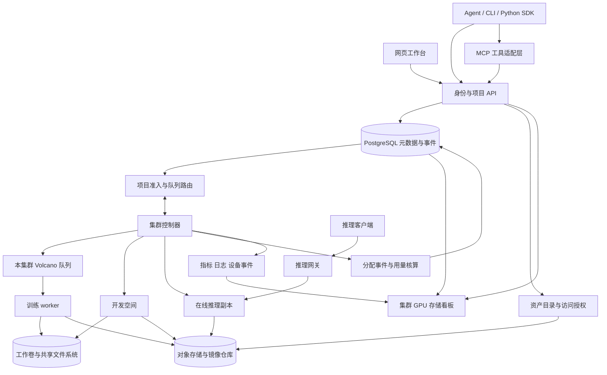

# 机器学习平台系统架构

训练、推理和开发空间共享项目权限、AI 资产、资源目录和计量规则，各自保留适合的执行方式。核心关联链是 **项目 → 工作负载 → 本次执行 → 资源分配 → 用量明细**。模型版本另外关联来源运行、评估和线上发布版本。产品中的排队解释、GPU 故障追踪、成本分摊都沿这些关系查询。[产品设计](产品设计.md)

各模块的执行组件、按队列派发的协议、共享存储与数据预热流程详见[模块实现设计](模块实现设计.md)。

## 部署结构

控制面采用模块化 API 服务、可横向扩展的异步控制器和事务数据库。第一套集群即可承载完整产品。新增集群只注册能力与信任身份。训练进程、模型权重传输和线上请求走独立的数据路径。控制面维护期间，已就绪的推理副本继续按最后一次验证过的路由服务。

| 边界 | 推荐实现及责任 |
| --- | --- |
| 项目与资产 | PostgreSQL 保存身份映射、授权、版本、期望状态、分配与账本。对象存储保存不可变数据、模型和检查点。OCI 仓库保存运行镜像。大文件凭短期授权直接传输，分片上传完成并校验后才发布版本 |
| 项目准入与派发 | 校验所选队列的项目授权，查出其唯一所属集群，在项目配额和预算内生成预留。训练的所有尝试都绑定本次提交的队列与集群 |
| 集群执行 | 集群控制器向所选 Volcano Queue 提交训练作业，Volcano 在本集群按队列策略和 worker 资源请求进行调度。设备实际分配、共享卷挂载及 worker 就绪由集群反馈。[Volcano Queue](https://volcano.sh/docs/concepts/queue/) |
| 在线服务 | 服务控制器接收镜像、启动命令、监听端口、可选模型、GPU 套餐和副本数。网关提供内网端点、用户及服务凭证鉴权、限流和请求指标。环境配置决定创建或更新是否进入审批 |
| 可观测性与账单 | 时序库存设备和服务指标，日志系统按运行及尝试索引。计量服务消费分配事件，生成可复核的用量区间。看板关联这三类数据，并标明来源和新鲜度 |

## 资源模型和状态

| 资源 | 身份与约束 |
| --- | --- |
| 项目、队列与套餐 | 项目关联承担费用的内部团队。平台队列 ID 映射到集群 ID、Volcano Queue 名称和 UID，同名的跨集群队列各有独立 ID。GPU 套餐定义 GPU 类型及每个 worker 的卡数。提交时保存队列映射、每个 worker 的套餐及其规格快照 |
| 资产版本 | 不可变 ID、内容摘要、上游版本、访问策略和存储位置。模型另含输入输出签名、运行环境、评估及部署兼容性。导入外部资产同样记录来源 |
| 工作负载与尝试 | 开发空间、训练运行、批量任务、推理服务各有稳定 ID。重试产生新的尝试。主动以新参数复跑产生新的运行，并指向来源。流水线保存各步骤运行 ID |
| 资源分配 | 每段分配关联项目、Pod、尝试、设备和绑定时间，供调度与故障分析使用。另存 Pod 运行区间作为 GPU 成本依据。物理卡用设备 UUID 标识，切片额外记录父卡、配置代次和规格 |
| 推理服务配置版本 | 固定镜像摘要、启动命令、端口、GPU 套餐及副本数，可选挂载固定版本的模型。指定环境的审批绑定到本次配置，普通环境直接应用 |
| 设备事件与账务记录 | 设备事件关联集群、节点、设备及受影响的分配。用量、价目表、账期和调整记录均可反查原始证据 |

训练的主要状态为「已提交 → 排队 → 启动中 → 运行中 → 成功」。失败时按用户配置的重试条件和次数进入「等待重试」或「失败」，取消时停止重试。每次尝试保存独立 Pod 记录。执行结果、整目录归档、模型登记和训练卷回收分别更新状态。开发空间单独记录计算实例和持久卷状态。推理服务报告期望版本、实际就绪版本和副本数。心跳超时时展示最后观测时间。

## 用户与 agent 的接口契约

HTTP API 是统一业务入口，以 OpenAPI 发布版本化契约。CLI、SDK、网页和 MCP 工具都调用同一层。所有资源返回稳定 ID 和网页链接。MCP 提供带输入结构的任务级工具，如预检训练、提交运行、比较结果和查询账单。工具目录只展示调用方可用能力，服务端对每个请求重新鉴权。[OpenAPI 规范](https://spec.openapis.org/oas/v3.1.1.html) · [MCP 工具规范](https://modelcontextprotocol.io/specification/2025-11-25/server/tools)

| 操作契约示例 | 请求及结果 |
| --- | --- |
| 预检与提交 | `POST /v1/projects/{id}/run-previews` 返回队列所属集群、各 worker 的套餐、按型号汇总的 GPU 需求、共享卷和数据读取方式。`POST /v1/projects/{id}/runs` 重新核验授权、队列身份、套餐、输入可达性、配额与预算，持久化后返回 202、运行 ID 和状态地址 |
| 等待与接手 | `GET /v1/runs/{id}` 返回状态、尝试、失败分类、可用动作与链接。事件流支持用游标续读，过期游标指引客户端重新获取快照 |
| 开发空间与推理服务 | 空间支持创建、停止、恢复与生成训练草稿。用户可创建或更新推理服务的模型、GPU 套餐及副本数。并发变更携带预期版本，指定审批环境校验与配置版本一致的审批记录 |
| 看板与费用 | 查询资源池容量、设备健康、存储指标、用量和账单行使用相同筛选维度。响应带单位、聚合窗口、采样覆盖或结算状态。大结果按稳定游标分页，导出异步执行 |

创建或有外部影响的请求携带幂等键。服务端按项目、调用主体、操作和键保存请求摘要及结果。同键同内容返回原资源，同键不同内容返回冲突。记录至少保留至操作结束后 7 天。错误包含稳定的原因码、可重试属性、字段位置和请求 ID。例如 `QUOTA_EXCEEDED` 给出受限队列与可用量，`PLACEMENT_PENDING` 作为排队原因随状态返回。agent 可以按返回的间隔等待，不必解析日志来猜状态。

人通过组织身份登录。项目成员可读本项目训练日志、归档和模型文件，所有者或项目管理员可修改或删除。另按资产类型授权，同团队项目可用数据集和模型，跨团队共享须显式授权。agent 代办训练和预热时，费用归委托用户，审计同时记录实际 agent、委托者和请求 ID。指定环境由环境管理员配置审批人或审批组，审批记录绑定本次目标配置。

## 调度与资源效率

1. **解析队列与套餐。** 按用户所选 Volcano 队列确定集群，核对该集群的 GPU 型号、每个 worker 的卡数、拓扑和共享存储。套餐映射为节点型号约束及设备数量请求。所选队列不支持的套餐返回原因，临时容量不足则在原队列等待。
2. **在指定集群放置。** 控制面只向队列所属集群派发。需要全员启动的分布式训练按组准入，若成员未能在时限内就绪，清理本次分配后回到原队列。失败原因可细化到「该队列需要同节点 4 张 A100，当前最多可提供 2 张」。
3. **采用队列管理员配置的策略。** 集群按 Volcano 生效的队列和调度器配置执行优先级、回填、抢占等行为。平台读取策略及调度事件解释等待原因，并审计管理员的配置变更。
4. **登记实际分配。** 整卡、硬件切片和允许的共享模式分别建池、定价和展示隔离等级。MIG 切片只在受支持的设备和规格上启用。修改分区布局先排空受影响设备。已绑定与预留分别计数，预留超时由协调器释放。[NVIDIA MIG 使用指南](https://docs.nvidia.com/datacenter/tesla/mig-user-guide/latest/getting-started-with-mig.html)
5. **核对效率收益。** 分别记录排队、镜像拉取、用户发起的数据预热、有效训练和故障重算时间。预热副本按资产版本和目标集群复用，直读 OSS 按用户所选版本访问源对象。流水线步骤仅在声明可复用、输入/参数/代码/环境均一致且调用者有权限时复用产物。

## 执行与数据保护

**开发空间。** 管理计算实例与独立的持久工作卷。回收策略读取配置的 CPU、GPU 利用率阈值和时间窗口，满足条件时终止实例并记录命中依据。缺失样本记为未知，纯 CPU 实例按适用指标判定。停止时刷新文件并解除挂载，恢复前核对卷位置与写入者。

**训练。** 将 GitLab 引用固定到 commit，保存镜像、数据读取模式、worker 套餐和用户重试配置。启动前按运行 ID 分配一个训练专属共享卷，所有 worker 可见 `/input` 和 `/output`。每次尝试的输出分别定位，同一运行重试时暴露之前的检查点位置。平台只按配置重新执行启动命令，checkpoint 的识别、验证和 resume 由用户代码实现。训练代码可以上报实际加载的检查点以供页面展示。

**推理。** 固定用户提供的镜像摘要、启动命令、端口、GPU 套餐和副本数，若挂载模型则固定其版本。控制器依据环境配置直接执行或进入审批。服务就绪后通过内网地址提供推理，网关校验用户或服务身份及调用权限。平台返回实际就绪副本与观测指标，由用户自行压测。批推理按分片提交输出。

**存储。** 数据集与预热副本独立于训练卷。训练卷按运行 ID 统一分配并由各次尝试复用。最终结束且 worker 停止写入后，把整个 `/output` 及相对路径、清单写入平台管理的 OSS，按项目和运行 ID 定位。校验成功后回收源卷，失败则保留源卷并重试。归档默认长期保留，允许所有者或项目管理员手动删除。模型登记须取得独立的持久对象或受保护的内容引用后才可标记成功。删除归档可释放该归档的引用，模型集引用的内容必须继续可读。

## GPU 稳定性与故障恢复

资源入池前登记集群身份、机型、驱动和存储能力。新节点完成设备枚举、显存与计算诊断、多卡通信测试和卷读写探测后才接收正式任务。驱动或固件升级先排空少量节点，在相同工作负载下比较错误率、训练吞吐和推理延迟，再逐批扩大。退役先关闭新准入，待作业结束或经用户处置、卷解除挂载、计量区间闭合后撤销集群凭证。

每张卡记录型号、UUID、节点、驱动、固件、拓扑与维护历史。NVIDIA 参考实现使用 DCGM 采集设备健康、温度、功耗及受支持的错误指标，结合驱动 Xid、作业退出原因和节点事件归因。不同设备的能力按发现结果登记。单个作业显存不足通常先归为工作负载问题。处置策略按错误类别、影响范围、重复频率和设备型号分别配置。[NVIDIA DCGM 功能说明](https://docs.nvidia.com/datacenter/dcgm/latest/user-guide/feature-overview.html) · [NVIDIA Xid 错误指南](https://docs.nvidia.com/deploy/xid-errors/latest/index.html)

| 事件 | 平台处置 | 恢复条件 |
| --- | --- | --- |
| 严重设备错误或反复掉卡 | 平台自动对受影响节点执行 cordon，记录触发原因和现有 Pod，通知训练用户硬件故障及真实任务状态 | 运维 agent 在适当条件下复测，通过后仅解除本次隔离。复测失败或需要人工维修时通知运维同学。cordon 影响新的常规调度，运行中的 Pod 由工作负载控制器分别处理。[Kubernetes 节点调度](https://kubernetes.io/docs/concepts/architecture/nodes/) |
| 分布式训练丢失成员 | 通知用户本次尝试失败。旧成员组停止或隔离后，只有用户重试配置允许才在原队列重新启动。新尝试启动后发送重启通知 | 仅当前尝试可提交最终结果。上一次尝试的输出在本运行的训练卷上可访问，训练程序自行决定是否续训 |
| 集群控制器失联 | 冻结该集群新分配，标明最后观测时间。现有服务用本地路由继续运行，分配事件在集群侧持久缓冲 | 重连后先按事件序号和实际库存对账。完成旧执行隔离或终止确认后才允许重复执行有副作用的工作 |
| 单项遥测中断 | 标记受影响指标的缺测区间。关键设备健康信号超时后，在该设备上暂停新分配，其他健康池照常运行 | 补采恢复并通过健康检查后解除限制，账单按分配事件独立核对 |
| 控制器重启或事件重投 | 期望状态、任务 ID、状态变更与待投递事件在同一事务写入。协调器重新读取未完成操作，按稳定 ID 查找已有集群对象 | 事务条件更新限制唯一有效尝试。事件消费者按事件 ID 去重，重复发布、取消和用量事件均可重放 |

按型号与资源池观察每千个已分配 GPU 小时的设备故障中断次数，以及发现到隔离、隔离到恢复的时长。故障报告区分已确认设备故障、应用错误与待归因事件，支持从异常驱动版本下钻到受影响卡和工作负载。

## 看板的数据路径

集群控制器提供资源清单、绑定、排队原因和更新时间。GPU 与存储采集器提供按设备或存储池标识的时序指标。查询服务先根据项目授权筛选资源，再按指标时间与当时有效的分配区间关联到任务。这样可以从昨天的一次温度异常找到当时占卡的作业，即使今天设备已经分给其他项目。

总览读取按集群、资源池和时间窗预聚合的结果。单个运行的日志、设备原始采样和账单行按需读取。看板同时给出分母、样本覆盖率和各后端实际支持的指标。共享对象存储若只能提供桶级延迟，就显示桶级观测和访问该桶的候选作业，具体请求归因依赖可关联的访问日志。

## 用量、费率与结算

**采集。** GPU 成本按 Pod 实际运行区间计量。以集群 ID、Pod UID 和区间起止为依据，保存实际生效的 GPU 型号与卡数、队列、worker、尝试、运行、用户、项目和团队。记录状态转换并在删除 Pod 前持久保存明细。尚未运行的 Pod 没有运行时长，重建 Pod 产生独立明细，丢失终止事件的区间先标记待核实。设备绑定记录另外用于故障定位。

**计算。** 按查询时窗与费率生效点切分各 Pod 的运行区间，金额等于各段运行小时数乘当期整套餐小时价，再求和。GPU 型号、卡数用于资源统计，费率键为套餐及其生效版本。卷按分配容量积分，预热与 OSS 归档按实际占用容量积分，各乘对应存储类别的费率。预热金额归原发起人，agent 代办时记委托用户。重复事件去重，汇总可追溯至 Pod 或存储资源。

**预算。** 提交时按规格、剩余额度和最长时长原子预占额度，运行中按实际用量消耗并释放差额。训练并发提交共享同一预算约束。启用硬上限的任务需有时限与停止策略。生产推理可设置独立保底预算和超额处理策略。预占额、预估费用、已确认费用分别显示。

**对账。** 开放区间用于当期估算，集群失联期间标记待核实。恢复后按资源记录、集群事件与存储清单核对。关账前处理缺口，已关账的费用通过关联原账单行的冲正或补记调整，保留原因与依据。团队可导出 GPU、存储明细和汇总，财务系统可按账期与版本增量同步。

## 验收与故障演练

以下是待压测的设计目标。参考测试规模为 3 个集群、256 张物理 GPU、100 个项目、1 万条活跃或近期工作负载。延迟测试另需记录后端配置、资源池水位、模型大小和数据位置。冷启动、资源紧张与缺测单独出报告。

| 场景 | 验收目标或核对方法 |
| --- | --- |
| 控制面响应 | 在每秒 100 次元数据读取和 10 次提交、持续 30 分钟的负载下，查询 P95 ≤ 300 毫秒，受理提交 P95 ≤ 1 秒。计时到持久化确认，单列后续排队与启动时长 |
| 调度与看板 | 有兼容空闲资源、集群健康且无高优先级阻塞时，提交至绑定 P95 ≤ 10 秒。集群、GPU 和存储实时指标端到端新鲜度 P95 ≤ 30 秒，超过采集阈值显示过期 |
| 设备隔离与分布式作业 | 注入一个已配置为严重的设备事件。从平台收到事件至禁止新分配 P95 ≤ 30 秒。并发投放任务验证隔离生效。检查原成员组退出、最终产物唯一、费用区间可复核 |
| 线上推理 | 以固定模型、GPU 套餐、副本数、输入分布与并发运行压测。平台能查询期望及实际就绪副本和请求指标，用户自行检验 P95/P99、吞吐与错误率目标 |
| 可用性与灾备 | 高可用部署的控制 API 月可用性目标 99.9%。跨故障域部署数据库与副本，数据库基础备份配合持续日志归档。对象按已配置的灾备策略保留可恢复版本。在隔离环境恢复并校验引用完整性，以已提交元数据及其已发布资产为范围，目标 RPO ≤ 5 分钟、RTO ≤ 60 分钟。工作卷另按所选快照策略验收。[PostgreSQL 时间点恢复](https://www.postgresql.org/docs/current/continuous-archiving.html) |
| 用量一致性与隔离 | 重放并乱序投递 Pod 起止事件及卷创建、回收事件，覆盖跨费率与账期场景，核对原始区间与重算结果。跨团队复用同一预热副本时，存储账单仍归预热发起人 |

上线评审可用任意分布式训练。模拟硬件故障并验证配置驱动的重试、用户代码上报的续训情况、完整输出归档和训练卷回收。以归档模型创建指定套餐和副本数的推理服务，分别验证普通环境与指定审批环境，并从账单复算 Pod 运行时长和预热发起人的存储费用。
