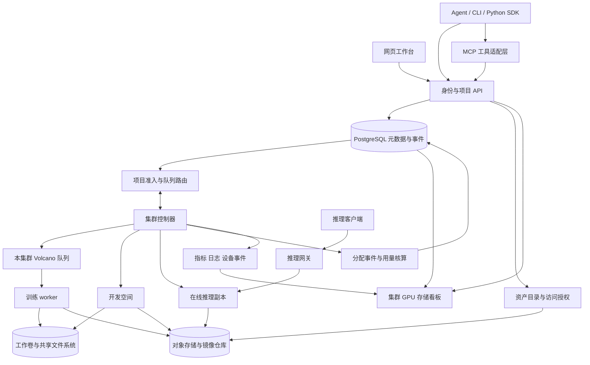

# 机器学习平台系统架构

训练、推理和开发空间共享项目权限、AI 资产、资源目录和计量规则，各自保留适合的执行方式。核心关联链是 **项目 → 工作负载 → 本次执行 → 资源分配 → 用量明细**。模型版本另外关联来源运行、评估和线上发布版本。产品中的排队解释、GPU 故障追踪、成本分摊都沿这些关系查询。[产品设计](产品设计.md)

各模块的执行组件、按队列派发的协议、共享存储与数据预热流程详见[模块实现设计](模块实现设计.md)。

## 部署结构

控制面采用模块化 API 服务、可横向扩展的异步控制器和事务数据库。第一套集群即可承载完整产品。新增集群只注册能力与信任身份。训练进程、模型权重传输和线上请求走独立的数据路径。控制面维护期间，已就绪的推理副本继续按最后一次验证过的路由服务。

| 边界 | 推荐实现及责任 |
| --- | --- |
| 项目与资产 | PostgreSQL 保存身份映射、授权、版本、期望状态、分配与账本。对象存储保存不可变数据、模型和检查点。OCI 仓库保存运行镜像。大文件凭短期授权直接传输，分片上传完成并校验后才发布版本 |
| 项目准入与派发 | 校验所选队列的项目授权，查出其唯一所属集群，在项目配额和预算内生成预留。训练的所有尝试都绑定本次提交的队列与集群 |
| 集群执行 | 集群控制器向所选 Volcano Queue 提交训练作业，Volcano 在本集群按队列策略和 worker 资源请求进行调度。设备实际分配、共享卷挂载及 worker 就绪由集群反馈。[Volcano Queue](https://volcano.sh/docs/concepts/queue/) |
| 在线服务 | 发布控制器管理模型版本、副本和流量配置。推理网关处理鉴权、路由、限流与请求指标。有独立的推理容量下限和伸缩策略 |
| 可观测性与账单 | 时序库存设备和服务指标，日志系统按运行及尝试索引。计量服务消费分配事件，生成可复核的用量区间。看板关联这三类数据，并标明来源和新鲜度 |

## 资源模型和状态

| 资源 | 身份与约束 |
| --- | --- |
| 项目、队列与套餐 | 项目关联承担费用的内部团队。平台队列 ID 映射到集群 ID、Volcano Queue 名称和 UID，同名的跨集群队列各有独立 ID。GPU 套餐定义 GPU 类型及每个 worker 的卡数。提交时保存队列映射、每个 worker 的套餐及其规格快照 |
| 资产版本 | 不可变 ID、内容摘要、上游版本、访问策略和存储位置。模型另含输入输出签名、运行环境、评估及部署兼容性。导入外部资产同样记录来源 |
| 工作负载与尝试 | 开发空间、训练运行、批量任务、推理服务各有稳定 ID。重试产生新的尝试。主动以新参数复跑产生新的运行，并指向来源。流水线保存各步骤运行 ID |
| 资源分配 | 每段分配持有唯一 ID，关联项目、执行实例、资源单位、绑定与释放时间。物理 GPU 用设备 UUID 标识，切片额外记录父卡、分区配置代次和切片规格 |
| 服务发布版本 | 固定模型、预处理、运行镜像、配置和签名。流量变更独立带版本。别名更新、模型归档和重试均不能隐式修改线上流量 |
| 设备事件与账务记录 | 设备事件关联集群、节点、设备及受影响的分配。用量、价目表、账期和调整记录均可反查原始证据 |

训练的主要状态为「已提交 → 排队 → 启动中 → 运行中 → 成功」。可恢复故障进入「等待重试」，耗尽次数或遇到应用错误后进入「失败」。取消先进入「取消中」，确认执行停止且资源释放后进入「已取消」。开发空间单独区分就绪、停止中、已停止和卷保留。在线服务同时报告期望版本、实际就绪版本、各版本流量和最近一次发布结果。心跳超时时展示「观测过期」和最后观测时间，保留底层执行是否停止的不确定性。

## 用户与 agent 的接口契约

HTTP API 是统一业务入口，以 OpenAPI 发布版本化契约。CLI、SDK、网页和 MCP 工具都调用同一层。所有资源返回稳定 ID 和网页链接。MCP 提供带输入结构的任务级工具，如预检训练、提交运行、比较结果和查询账单。工具目录只展示调用方可用能力，服务端对每个请求重新鉴权。[OpenAPI 规范](https://spec.openapis.org/oas/v3.1.1.html) · [MCP 工具规范](https://modelcontextprotocol.io/specification/2025-11-25/server/tools)

| 操作契约示例 | 请求及结果 |
| --- | --- |
| 预检与提交 | `POST /v1/projects/{id}/run-previews` 返回队列所属集群、各 worker 的套餐、按型号汇总的 GPU 需求、共享卷和数据读取方式。`POST /v1/projects/{id}/runs` 重新核验授权、队列身份、套餐、输入可达性、配额与预算，持久化后返回 202、运行 ID 和状态地址 |
| 等待与接手 | `GET /v1/runs/{id}` 返回状态、尝试、失败分类、可用动作与链接。事件流支持用游标续读，过期游标指引客户端重新获取快照 |
| 开发、发布与回滚 | 空间支持创建、停止、恢复与生成训练草稿。服务通过发布版本及流量变更操作上线和回滚。并发变更携带预期版本，冲突时返回当前版本供重新判断 |
| 看板与费用 | 查询资源池容量、设备健康、存储指标、用量和账单行使用相同筛选维度。响应带单位、聚合窗口、采样覆盖或结算状态。大结果按稳定游标分页，导出异步执行 |

创建或有外部影响的请求携带幂等键。服务端按项目、调用主体、操作和键保存请求摘要及结果。同键同内容返回原资源，同键不同内容返回冲突。记录至少保留至操作结束后 7 天。错误包含稳定的原因码、可重试属性、字段位置和请求 ID。例如 `QUOTA_EXCEEDED` 给出受限队列与可用量，`PLACEMENT_PENDING` 作为排队原因随状态返回。agent 可以按返回的间隔等待，不必解析日志来猜状态。

人通过组织身份登录。agent 可以使用独立服务身份，或由用户委托获得限定项目、动作、预算和有效期的短期凭证。审计同时记录实际调用者、委托者、变更前后版本和请求 ID。跨租户工作负载隔离计算、网络、卷和密钥。跨租户共享通过显式资产授权。生产发布控制器校验审批记录与本次环境、模型和流量方案一致。任一项变更即需重新审批，网页、API 和 agent 共用该检查。

## 调度与资源效率

1. **解析队列与套餐。** 按用户所选 Volcano 队列确定集群，核对该集群的 GPU 型号、每个 worker 的卡数、拓扑和共享存储。套餐映射为节点型号约束及设备数量请求。所选队列不支持的套餐返回原因，临时容量不足则在原队列等待。
2. **在指定集群放置。** 控制面只向队列所属集群派发。需要全员启动的分布式训练按组准入，若成员未能在时限内就绪，清理本次分配后回到原队列。失败原因可细化到「该队列需要同节点 4 张 A100，当前最多可提供 2 张」。
3. **按工作负载保护容量。** 在线推理保留最低副本和扩容余量，开发空间有交互配额，批训练按项目保底份额、公平共享和优先级排队。空闲份额可借用。仅对声明可抢占的任务回收借用容量，并给出保存检查点的期限。长时间等待的大任务可获得预留，小任务回填须满足预留时限。
4. **登记实际分配。** 整卡、硬件切片和允许的共享模式分别建池、定价和展示隔离等级。MIG 切片只在受支持的设备和规格上启用。修改分区布局先排空受影响设备。已绑定与预留分别计数，预留超时由协调器释放。[NVIDIA MIG 使用指南](https://docs.nvidia.com/datacenter/tesla/mig-user-guide/latest/getting-started-with-mig.html)
5. **核对效率收益。** 分别记录排队、镜像拉取、用户发起的数据预热、有效训练和故障重算时间。预热副本按资产版本和目标集群复用，直读 OSS 按用户所选版本访问源对象。流水线步骤仅在声明可复用、输入/参数/代码/环境均一致且调用者有权限时复用产物。

## 执行与数据保护

**开发空间。** 持久工作卷与临时运行容器分别管理。停止时刷新写入并解除挂载，恢复前核对卷可用区与访问模式。同一单写卷只允许一个有效写入者。失联时先完成旧实例隔离。生成训练草稿时将选定源码和运行环境固化，后台训练通过版本化输入访问数据。

**训练。** 将 GitLab 引用解析到具体 commit，固定镜像、输入模型、数据版本、读取模式与 worker 套餐。输入模型按配置从 OSS 下载。所有 worker 挂载相同的共享 `/input` 和本次尝试的共享 `/output`。`/output/ckpt` 的分片和清单完整后才可用于恢复，`/output/model` 存放待登记模型，`data`、`log` 和 `other` 存放其他产物。恢复只在原队列和集群新建尝试，并保留旧输出。无兼容检查点时，依据预算与重试策略处理。

**推理。** 生产环境部署之前验证审批已通过，候选版本通过就绪探针、签名校验和样例预测后，按已批准的流量方案放量。按错误率、延迟和有效样本量观察质量，触发已批准的回滚条件时切回保留的健康版本。运行中的长请求按排空时限结束，扩缩容考虑并发和队列长度，生成式服务额外考虑 token 吞吐。批推理的每个分片独立提交输出，最终清单引用已完成分片。

**存储。** 对象存储承载不可变资产，共享文件系统承载训练输入与输出，工作卷承载交互写入。预热是一项由用户显式发起的操作，记录发起人、数据版本、目标集群与校验结果，完整可读后才挂入 `/input`。直读 OSS 使用对象地址和短期读取授权，训练调度、排队和恢复均不主动迁移数据。资产上传校验后再事务登记，清理时检查引用与保留期。

## GPU 稳定性与故障恢复

资源入池前登记集群身份、机型、驱动和存储能力。新节点完成设备枚举、显存与计算诊断、多卡通信测试和卷读写探测后才接收正式任务。驱动或固件升级先排空少量节点，在相同工作负载下比较错误率、训练吞吐和推理延迟，再逐批扩大。退役先关闭新准入，待作业结束或经用户处置、卷解除挂载、计量区间闭合后撤销集群凭证。

每张卡记录型号、UUID、节点、驱动、固件、拓扑与维护历史。NVIDIA 参考实现使用 DCGM 采集设备健康、温度、功耗及受支持的错误指标，结合驱动 Xid、作业退出原因和节点事件归因。不同设备的能力按发现结果登记。单个作业显存不足通常先归为工作负载问题。处置策略按错误类别、影响范围、重复频率和设备型号分别配置。[NVIDIA DCGM 功能说明](https://docs.nvidia.com/datacenter/dcgm/latest/user-guide/feature-overview.html) · [NVIDIA Xid 错误指南](https://docs.nvidia.com/deploy/xid-errors/latest/index.html)

| 事件 | 平台处置 | 恢复条件 |
| --- | --- | --- |
| 严重设备错误或反复掉卡 | 从可调度集合移除受影响卡。父卡故障覆盖其切片，共享互联或节点异常按故障域扩大范围。记录受影响分配，在原训练队列处理受影响的尝试，按已批准的部署配置替换推理副本 | 在排空的设备上诊断和试运行，满足观察窗口后重新入池，保留诊断与操作者记录 |
| 分布式训练丢失成员 | 终止或隔离旧成员组，释放整组分配。依据剩余预算、重试次数及检查点，在健康拓扑建立新尝试 | 只接受当前尝试的心跳、完成记录和产物清单。旧尝试的日志仍可查 |
| 集群控制器失联 | 冻结该集群新分配，标明最后观测时间。现有服务用本地路由继续运行，分配事件在集群侧持久缓冲 | 重连后先按事件序号和实际库存对账。完成旧执行隔离或终止确认后才允许重复执行有副作用的工作 |
| 单项遥测中断 | 标记受影响指标的缺测区间。关键设备健康信号超时后，在该设备上暂停新分配，其他健康池照常运行 | 补采恢复并通过健康检查后解除限制，账单按分配事件独立核对 |
| 控制器重启或事件重投 | 期望状态、任务 ID、状态变更与待投递事件在同一事务写入。协调器重新读取未完成操作，按稳定 ID 查找已有集群对象 | 事务条件更新限制唯一有效尝试。事件消费者按事件 ID 去重，重复发布、取消和用量事件均可重放 |

按型号与资源池观察每千个已分配 GPU 小时的设备故障中断次数，以及发现到隔离、隔离到恢复的时长。故障报告区分已确认设备故障、应用错误与待归因事件，支持从异常驱动版本下钻到受影响卡和工作负载。

## 看板的数据路径

集群控制器提供资源清单、绑定、排队原因和更新时间。GPU 与存储采集器提供按设备或存储池标识的时序指标。查询服务先根据项目授权筛选资源，再按指标时间与当时有效的分配区间关联到任务。这样可以从昨天的一次温度异常找到当时占卡的作业，即使今天设备已经分给其他项目。

总览读取按集群、资源池和时间窗预聚合的结果。单个运行的日志、设备原始采样和账单行按需读取。看板同时给出分母、样本覆盖率和各后端实际支持的指标。共享对象存储若只能提供桶级延迟，就显示桶级观测和访问该桶的候选作业，具体请求归因依赖可关联的访问日志。

## 用量、费率与结算

**采集。** 内部团队账单分 GPU 和存储两项归集成本。GPU 按实际绑定与释放区间、设备类型和数量计量，排队及未绑定的临时预留计量为零。存储按对应存储类别的 GiB·小时口径计量，预热数据和共享输出关联其团队和项目。多个 worker 挂载同一份数据只形成一份对应存储用量。CPU、内存指标用于资源监控。

**计算。** 按唯一分配或存储资源合并有效区间，在内部费率生效点和账期边界拆分。GPU 金额按型号汇总卡时乘对应费率，存储金额按类别汇总容量时乘对应费率。团队合计为两项之和，可反查项目、任务、资源区间和费率版本。财务按内部规则核对未分摊部分和调整项。

**预算。** 提交时按规格、剩余额度和最长时长原子预占额度，运行中按实际用量消耗并释放差额。训练并发提交共享同一预算约束。启用硬上限的任务需有时限与停止策略。生产推理可设置独立保底预算和超额处理策略。预占额、预估费用、已确认费用分别显示。

**对账。** 开放区间用于当期估算，集群失联期间标记待核实。恢复后按资源记录、集群事件与存储清单核对。关账前处理缺口，已关账的费用通过关联原账单行的冲正或补记调整，保留原因与依据。团队可导出 GPU、存储明细和汇总，财务系统可按账期与版本增量同步。

## 验收与故障演练

以下是待压测的设计目标。参考测试规模为 3 个集群、256 张物理 GPU、100 个项目、1 万条活跃或近期工作负载。延迟测试另需记录后端配置、资源池水位、模型大小和数据位置。冷启动、资源紧张与缺测单独出报告。

| 场景 | 验收目标或核对方法 |
| --- | --- |
| 控制面响应 | 在每秒 100 次元数据读取和 10 次提交、持续 30 分钟的负载下，查询 P95 ≤ 300 毫秒，受理提交 P95 ≤ 1 秒。计时到持久化确认，单列后续排队与启动时长 |
| 调度与看板 | 有兼容空闲资源、集群健康且无高优先级阻塞时，提交至绑定 P95 ≤ 10 秒。集群、GPU 和存储实时指标端到端新鲜度 P95 ≤ 30 秒，超过采集阈值显示过期 |
| 设备隔离与分布式作业 | 注入一个已配置为严重的设备事件。从平台收到事件至禁止新分配 P95 ≤ 30 秒。并发投放任务验证隔离生效。检查原成员组退出、最终产物唯一、费用区间可复核 |
| 线上推理 | 区分平台与模型的延迟预算。每个模型以指定硬件、请求分布和并发确定端到端 P95/P99、吞吐与错误率门槛。生产服务发布前按该档案压测。暖备健康时，回滚请求至新流量切回 P95 ≤ 60 秒 |
| 可用性与灾备 | 高可用部署的控制 API 月可用性目标 99.9%。跨故障域部署数据库与副本，数据库基础备份配合持续日志归档。对象按已配置的灾备策略保留可恢复版本。在隔离环境恢复并校验引用完整性，以已提交元数据及其已发布资产为范围，目标 RPO ≤ 5 分钟、RTO ≤ 60 分钟。工作卷另按所选快照策略验收。[PostgreSQL 时间点恢复](https://www.postgresql.org/docs/current/continuous-archiving.html) |
| 用量一致性与隔离 | 重放、打乱、延迟绑定与释放事件，覆盖跨价目表、跨月和已关账场景。最终区间与独立重算一致。用跨项目身份验证数据、日志、设备明细和账单的访问边界 |

上线评审以一项真实的多卡作业贯穿全程。评审者从开发空间提交训练，在设备故障后恢复运行，登记模型、经生产审批后灰度上线并按方案回滚，再从账单追溯全部资源区间。该记录也作为网页、公共 API 和 agent 工具等价性的验收样例。
